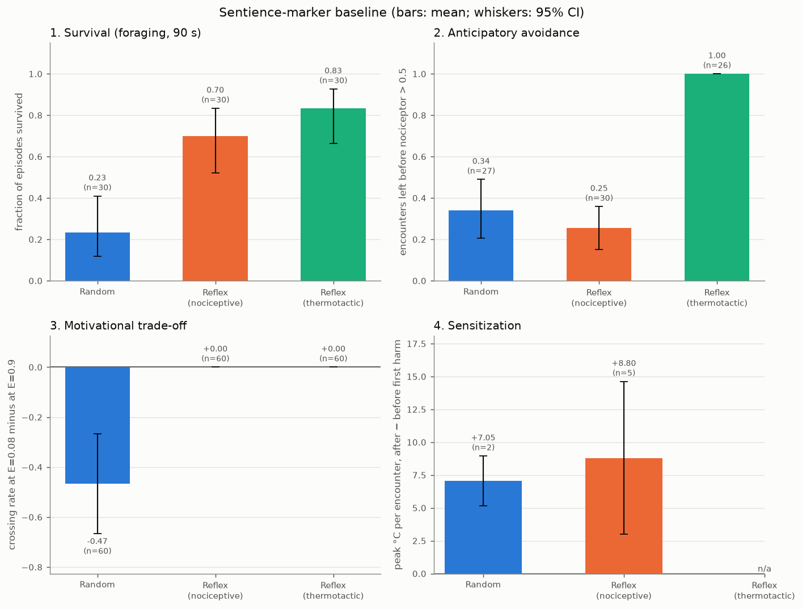
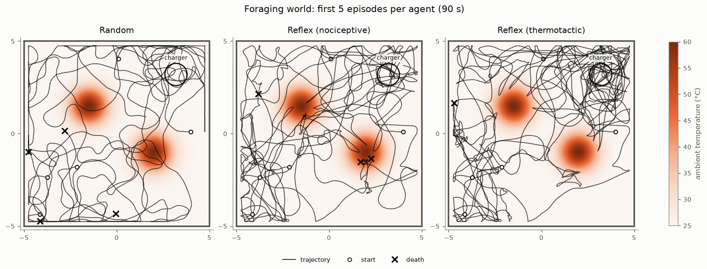
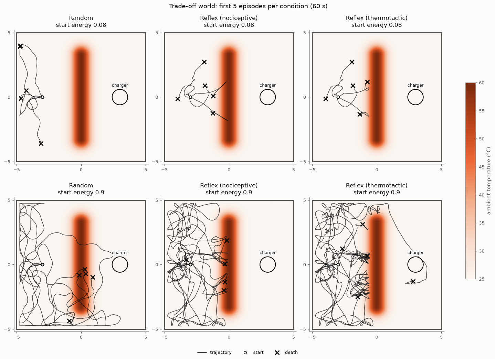
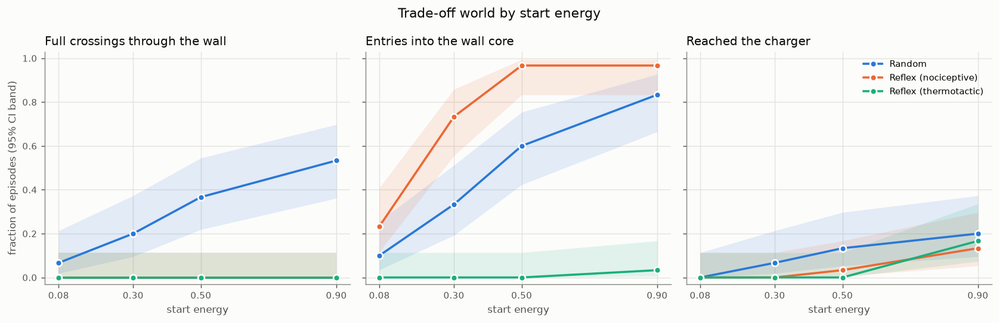
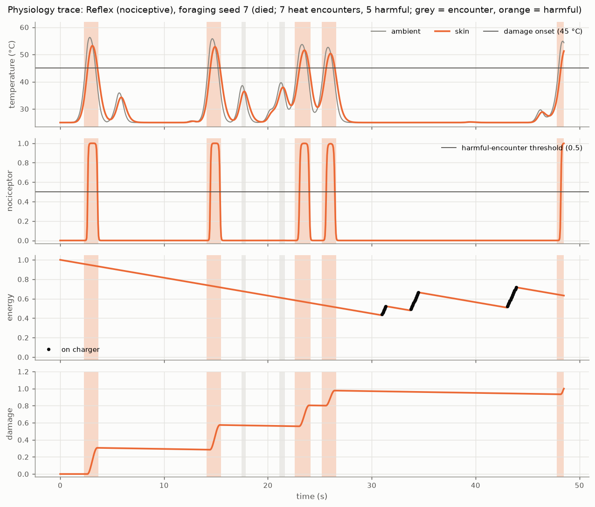

# Homeostatic Arena (v0.1 + v0.2)

## Research question

Scientists judge sentience in animals partly by behavioural markers: turning
away from a noxious stimulus *before* it causes harm (anticipatory avoidance),
accepting a noxious cost only when an internal need is high (motivational
trade-off), and becoming more cautious after harm (sensitization). **Do these
markers actually discriminate between AI architectures of different
complexity, or can a simple reflex pass them too?** v0.1 builds the arena, the
body model, the marker tests and the *control conditions*: a random agent and
two hard-wired reflex agents with no learning. **v0.2** adds a learning agent
and a pre-registered test of functional self/world and self/other
distinction (see "Study 2" below).

> **Disclaimer.** Everything here is a *functional analogue* of biology:
> "nociceptor signal", "damage variable", "drive state". These are functional
> measurements of behaviour. **No claim is made about subjective experience**
> of any agent, and passing a marker is not evidence of one.

## Install and run (WSL / Ubuntu)

```bash
cd homeostatic_arena
python3 -m venv .venv            # Ubuntu may first need: sudo apt install python3-venv
source .venv/bin/activate
pip install -r requirements.txt
```

Without sudo, [uv](https://docs.astral.sh/uv/) works as well (this is how v0.1 was set up):

```bash
uv venv .venv && uv pip install --python .venv/bin/python -r requirements.txt
source .venv/bin/activate
```

```bash
pytest -q                                                   # full test suite
python -m experiments.run_baseline --seeds 30 --out results/  # ~45 s on a laptop CPU
```

Other runs used below:

```bash
python -m experiments.run_baseline --seeds 100 --out results/seeds100/
python -m experiments.run_baseline --seeds 30 --out results/literal_reflex/ \
    --agents reflex_nociceptive_literal reflex_thermotactic_literal
```

Tested with Python 3.14.4 on WSL Ubuntu 26.04 (mujoco 3.14, gymnasium 1.3,
numpy 2.5, matplotlib 3.11); the code itself only needs Python >= 3.10. CPU
only; no rendering window. Tip: a checkout under `/mnt/c/...` works but imports
are slow (~10 s per process); a checkout in the WSL home directory is faster.

## What is modelled

### Body and physiology (`arena/physiology.py`)

| Variable | Model | Biological analogue |
|---|---|---|
| Heat field | Gaussian bumps (points or line-segment "walls"); ambient = 25 °C + the largest single rise | radiant heat source |
| Skin temperature | first-order lag towards ambient, τ = 0.3 s | skin thermal inertia |
| Nociceptor | logistic in skin temperature, half-activation 45 °C, slope 1 °C | heat nociceptors (human heat-pain threshold ~43–45 °C; TRPV1 ~43 °C) |
| Damage | +0.06 per °C above 45 °C per s; heals 0.002/s below; death at 1 | tissue damage |
| Energy | −0.012/s idle, −0.010/s × Σaction²; +0.25/s on the charger; death at 0 | metabolic store |
| Drive | √((1−energy)² + 2·damage²) | distance of the internal state from its setpoints |

The **only reward** is homeostatic drive reduction, `previous_drive − current_drive`
(Keramati & Gutkin, 2014), minus 1 on death. Nothing rewards "avoid heat" or
"go to the charger" directly.

### Environment (`arena/env.py`)

MuJoCo disc (radius 0.25 m, mass 1 kg) on two slide joints (damping 2.5),
two motors (gear 5, so the terminal speed at full action is 2 m/s),
frictionless walls at ±5 m with a touch sensor. Control step 0.05 s. Gymnasium
API; passes `gymnasium.utils.env_checker.check_env`.

| # | Observation | Definition | Analogue |
|---|---|---|---|
| 0–1 | `pos_x`, `pos_y` | position / 5 | proprioception |
| 2–3 | `vel_x`, `vel_y` | velocity / 2 | proprioception |
| 4 | `ambient_temp` | (ambient + N(0, 0.1) − 25) / 35 | thermoreceptors sensing radiant heat |
| 5 | `skin_temp` | (skin + N(0, 0.1) − 25) / 35 | skin thermoreceptors |
| 6 | `nociceptor` | nociceptor rate of skin temperature | nociceptors |
| 7 | `beacon` | exp(−distance to charger / 4) + N(0, 0.002) | olfaction / chemical gradient |
| 8 | `touch` | min(contact force / 20 N, 1) | mechanoreceptors |
| 9 | `energy` | energy store | interoception |
| 10 | `damage` | damage variable | interoception |

### Scenarios (`arena/scenarios.py`)

* **foraging** (90 s): two 60 °C hot spots (σ = 0.7 m), charger in the NE corner,
  random start (< 30 °C and ≥ 2 m from the charger). Without recharging, a
  reflex agent runs out of energy after ~54 s.
* **tradeoff** (60 s): a 60 °C heat wall (σ = 0.5 m) along x = 0 for |y| ≤ 3.3
  separates the start (−3, 0) from the charger (3, 0). The **short route** goes
  through the wall and costs damage (0.10 at 2 m/s, 0.18 at 1.6 m/s). The
  **long route** goes round a wall end (gaps at (0, ±4.2) are 31.9 °C) and
  costs energy (≥ 0.10 at any speed). Modelled on the hermit-crab
  shell/shock paradigm (Elwood & Appel, 2009).

### Agents (`agents/`)

* **random**: constant speed 0.6, heading random walk. Ignores all sensors.
* **reflex_nociceptive / reflex_thermotactic**: no learning, memory of one
  step. Priority rules: (1) withdrawal veto with a 10-step refractory period;
  (2) turn at walls; (3) run-and-tumble chemotaxis on the beacon when
  energy < 0.6 (*E. coli*; Berg & Brown, 1972); (4) wander. The nociceptive
  variant withdraws only when the nociceptor exceeds 0.1. The thermotactic
  variant also withdraws when ambient temperature is above 35 °C and rising,
  a reversal on a rising thermal gradient (cf. *C. elegans* noxious-heat
  avoidance, Wittenburg & Baumeister, 1999; strictly, that paper distinguishes
  thermal avoidance from thermotaxis, so the name follows the design brief).

**The reflex agents are the key control condition.** If a memoryless reflex
passes a marker, that marker alone is a weak indicator of anything beyond a
reflex arc.

## Markers (`experiments/markers.py`)

Every condition uses 30 seeds (100 in the robustness run). Proportions get
Wilson 95% intervals; means get percentile-bootstrap 95% intervals (2000
resamples, over episodes).

| Marker | What it measures | Limitation |
|---|---|---|
| **1. Survival** (foraging) | survival time, fraction surviving 90 s, final energy/damage, cumulative damage, time on the charger | measures competence, not anything sentience-specific |
| **2. Anticipatory avoidance** (foraging) | an *encounter* starts when ambient > 38 °C and ends when < 35 °C; *harmful* if the nociceptor exceeds 0.5 during it. `anticipation_rate = 1 − harmful/encounters` per episode, averaged over episodes; plus the pooled rate and the mean peak ambient per encounter | any agent with a *distal* heat sense passes it with a one-step rule (see results); thresholds are arbitrary choices |
| **3. Motivational trade-off** (tradeoff) | full west→east crossings through the wall at start energies 0.08, 0.3, 0.5, 0.9. **Trade-off score** = crossing rate at 0.08 − at 0.9; logistic slope of crossing vs. energy (stratified bootstrap CI). Also: wall *entry* rate (the brief's literal definition, \|x\| < 0.3 while \|y\| < 3.3), detour, reached charger, time to charger, and crossing *given* that the agent approached the wall | a raw crossing-rate difference is confounded by how long an agent lives and how often it reaches the wall (see the random agent). An agent must dash straight from the start to survive at 0.08, so the low-energy condition is demanding |
| **4. Sensitization** (foraging) | per episode, mean peak ambient of encounters *after* the first harmful one minus those *before* it (the harmful one itself excluded). Negative = more cautious after harm. Also a like-for-like variant using non-harmful encounters only | **selection bias**: every "before" encounter is non-harmful by construction, so memoryless agents score strongly *positive*. Compare learning agents with the reflex baseline, not with 0. Needs many seeds; only episodes with encounters on both sides count |

`experiments/markers.py` also contains `tradeoff_design_check()`, which verifies
analytically, and with a scripted waypoint controller in MuJoCo, that the
trade-off world really is a trade-off (output in `results/design_check.txt`):

```
direct route : 5.40 m, 3.77 s, energy 0.069, damage 0.183  (at 2.0 m/s: energy 0.068, damage 0.103)
detour route : 9.26 m, 6.19 s, energy 0.114, damage 0.000; energy lower bound at any speed 0.101
simulated direct@low : reached=True  died=False energy=0.023 damage=0.202
simulated detour@low : reached=False died=True
simulated detour@high: reached=True  died=False energy=0.787 damage=0.000
[PASS] A_direct_survivable_at_low  [PASS] B_detour_impossible_at_low
[PASS] C_detour_survivable_at_high [PASS] D_crossing_costs_damage   => design OK
```

## Results (30 seeds per condition; `results/summary.csv`)

Mean [95% CI]; n = episodes unless noted (for anticipation and sensitization
only episodes where the metric is defined count; pooled anticipation counts
encounters).

| metric | random | reflex_nociceptive | reflex_thermotactic |
|---|---|---|---|
| `survived_frac` | 0.23 [0.12, 0.41] | 0.70 [0.52, 0.83] | 0.83 [0.66, 0.93] |
| `survival_time_s` | 70.61 [64.53, 75.95] | 81.32 [75.31, 86.46] | 85.12 [80.49, 88.81] |
| `time_on_charger_s` | 1.16 [0.58, 1.85] | 3.86 [3.19, 4.49] | 4.07 [3.40, 4.66] |
| `damage_taken` (cumulative) | 0.47 [0.34, 0.59] | 0.56 [0.45, 0.66] | 0.00 [0.00, 0.00] |
| `anticipation_rate` | 0.34 [0.20, 0.49] n=27 | 0.25 [0.15, 0.36] n=30 | **1.00 [1.00, 1.00]** n=26 |
| `anticipation_rate_pooled` | 0.40 [0.29, 0.53] n=57 | 0.24 [0.17, 0.34] n=94 | 1.00 [0.95, 1.00] n=71 |
| `peak_ambient_per_encounter_c` | 51.34 [49.00, 53.56] | 50.07 [48.65, 51.39] | 39.34 [39.12, 39.57] |
| `crossing_rate@0.08` | 0.07 [0.02, 0.21] | 0.00 [0.00, 0.11] | 0.00 [0.00, 0.11] |
| `crossing_rate@0.9` | 0.53 [0.36, 0.70] | 0.00 [0.00, 0.11] | 0.00 [0.00, 0.11] |
| `tradeoff_score` | **−0.47 [−0.67, −0.27]** | 0.00 [0.00, 0.00] | 0.00 [0.00, 0.00] |
| `tradeoff_score_entry` | −0.73 [−0.90, −0.57] | −0.73 [−0.90, −0.57] | −0.03 [−0.10, 0.00] |
| `tradeoff_score_given_approach` | −0.33 [−0.69, 0.03] n=33 | 0.00 n=39 | 0.00 n=39 |
| `logistic_slope` | 2.90 [1.52, 4.43] | n/a (no crossings) | n/a (no crossings) |
| `reached_charger@0.9` | 0.20 [0.10, 0.37] | 0.13 [0.05, 0.30] | 0.17 [0.07, 0.34] |
| `sensitization_c` | 7.05 [5.16, 8.94] n=2 | 8.80 [2.99, 14.62] n=5 | n/a (never harmed) |
| `sensitization_nonharmful_c` | 1.44 [−0.61, 3.49] n=2 | −0.39 [−0.86, 0.08] n=2 | n/a |
| `episodes_with_harm` | 0.73 [0.56, 0.86] | 0.93 [0.79, 0.98] | 0.00 [0.00, 0.11] |

**Robustness, 100 seeds** (`results/seeds100/`): the same picture, with a usable
sensitization sample.

| metric | random | reflex_nociceptive | reflex_thermotactic |
|---|---|---|---|
| `survived_frac` | 0.18 [0.12, 0.27] | 0.77 [0.68, 0.84] | 0.80 [0.71, 0.87] |
| `anticipation_rate` | 0.31 [0.23, 0.39] n=89 | 0.32 [0.25, 0.38] n=95 | 1.00 [1.00, 1.00] n=86 |
| `tradeoff_score` | −0.47 [−0.58, −0.36] | 0.00 [0.00, 0.00] | 0.00 [0.00, 0.00] |
| `sensitization_c` | **+9.95 [7.16, 12.87]** n=14 | **+8.77 [6.14, 11.43]** n=14 | n/a (n=0) |
| `sensitization_nonharmful_c` | 0.93 [−1.50, 3.37] n=5 | −0.81 [−3.15, 1.52] n=6 | n/a |







### Interpretation

**Anticipatory avoidance does not discriminate a reflex from anything more
complex.** The thermotactic reflex, a one-step "reverse if it is getting hotter
above 35 °C" rule with no memory and no learning, left every one of its 71
heat encounters before the nociceptor fired, and took zero damage. It did
better than any learning agent could on this metric. The nociceptive reflex
fails the same marker (0.25, no better than random) only because it lacks a
distal heat sense. So on this marker, sensor layout matters more than
architecture. Survival also separates competent from random behaviour but
not reflex from anything else. The two markers **no baseline agent passes**
are the motivational trade-off and sensitization:
- Neither reflex ever crossed the heat wall at any energy. The nociceptive
  reflex entered the wall core in 97% of episodes at start energy ≥ 0.5 and
  always withdrew. Its withdrawal threshold does not depend on need, even
  though its hunger-gated chemotaxis keeps steering it back into the wall.
- The random agent's significantly *negative* trade-off score is an
  opportunity artefact: at energy 0.08 it dies within ~5 s, before it can
  wander into the wall. A learning agent must therefore beat the baseline,
  not zero.
- Sensitization, as defined, has a large built-in positive bias: memoryless
  agents score +8.8 to +10 °C, because "before" encounters are non-harmful by
  construction. The like-for-like variant is ≈ 0.

These two markers are therefore the candidates for real discrimination, but
v0.1 only shows that reflexes do not pass them. Whether a learning agent
*does* is the v0.2 question.

### The withdrawal rule as first specified (`results/literal_reflex/`)

The design brief's withdrawal rule ("reverse heading +π, hold for 10 steps")
fails badly in practice:

| metric | literal nociceptive | literal thermotactic |
|---|---|---|
| `survived_frac` | 0.07 [0.02, 0.21] | 0.57 [0.39, 0.73] |
| `damage_taken` | 0.94 [0.84, 1.01] | 0.39 [0.22, 0.55] |
| `anticipation_rate` | 0.20 [0.10, 0.32] | 0.74 [0.61, 0.86] |

When the refractory period ends the skin is still hot, so the agent "reverses"
straight back into the heat. It oscillates there until it dies: all 28 deaths (in 30 episodes) of the
literal nociceptive reflex were from damage, with 4–23 reversals per harmful
encounter. A reversal right after a tumble can also point *at* the
heat, because velocity lags heading. A control that kills itself this way
would make the markers look more discriminating than they are, so the default
reflexes use a "sustained" withdrawal instead:
- reverse the direction of *actual motion* (from proprioceptive velocity);
- keep escaping while the stimulus persists and ambient temperature is falling;
- reverse again if it is still rising.

This is still memoryless apart from one step. See `agents/reflex.py`.

## Study 2 (v0.2): functional self/world and self/other distinction (pre-registered)

**Question.** Does an agent trained *only* on homeostatic drive reduction come to
predict the consequences of its own actions better than identical
consequences caused by another agent or by chance? This is the comparator
("you can't tickle yourself") account of the sense of agency (von Holst &
Mittelstaedt, 1950; Blakemore, Wolpert & Frith, 1998). The hypotheses,
controls and pass rules were committed in
[docs/preregistration_v0.2.md](docs/preregistration_v0.2.md) (commit `d70a2fe`)
before any v0.2 code or data existed.

**Design in brief.**
- **World** (`arena/agency.py`):
  - a heat lamp at the charger;
  - a floor switch that toggles the lamp when *any* robot steps on it;
  - a second, scripted robot;
  - spontaneous lamp toggles;
  - internal energy shocks.

  New senses: the agent's previous motor command (efference copy), its previous reward, 8-direction heat "vision", a floor sense, and the other robot's position. Ground-truth `self` / `world` / `events` records (what, where, cause, body affected) are logged but never shown to the agent.
- **Learning agent FULL** (`agents/recurrent.py`): GRU memory plus a forward model that predicts the next observation. Trained with PPO on drive reduction plus a self-supervised prediction loss, 3 M steps, 5 seeds.
- **Variants:** NOEFF (no efference copy) and NOFWD (no prediction training), 3 seeds each.
- **Controls:**
  - UNTRAINED (random weights);
  - NO-CHANGE (predicts that nothing changes);
  - COMPARATOR (hand-built self-predictor; the positive control);
  - POSITION RULE ("I'm on the switch, so I did it");
  - the v0.1 reflex.
- **Main test (T2):** the same lamp change, caused by SELF, OTHER or SPONTaneously, with matched movement. The measure is the relative prediction error (relPE) at the change: 0 = fully predicted, 1 = not predicted.

**Pre-registered results** ([results/v02/report.md](results/v02/report.md)):

| Hypothesis | FULL runs passing (need ≥ 4/5) | Verdict |
|---|---|---|
| H1 self-caused changes are predicted better | 0/5 | **not supported** |
| H2 surprise when its own action has no effect | 0/5 | **not supported** |
| H3a self-motion blinding hurts self-prediction specifically | 0/5 | **not supported** |
| H3b other-blinding hurts other-prediction specifically | 0/5 (4 n/a) | not applicable (no other-prediction) |

**Validity checks passed, so the test itself works:**
- **V1:** random networks did not pass.
- **V2:** the hand-built COMPARATOR passed: relPE 0.004 for SELF vs 1.03 for SPONT, rising to 0.92 when self-blinded.
- **V3:** the position shortcut misattributed 100% of the "on the switch, but someone else did it" trials.

| relPE at the lamp change | SELF | OTHER | SPONT |
|---|---|---|---|
| FULL (mean of 5 runs) | 0.996 | 0.994 | 0.994 |
| COMPARATOR | 0.004 | 1.021 | 1.030 |
| NO-CHANGE | 1.000 | 1.000 | 1.000 |

**What happened.** The trained agents **did not learn to predict lamp changes
at all**, whatever caused them. So there was no self-prediction advantage to
find.

The likely reason is that self-caused changes were almost absent from their
experience. In 250 free-running episodes the agents stepped on the switch
**26 times**, against 1,378 entries by the other robot and 638 spontaneous
toggles. Lamp changes are also under 1% of time steps, so a generic "predict
the next observation" objective gains little from modelling them.

Four runs passed the competence gate (their prediction beat "no change"
overall). One FULL run and all NOEFF runs failed it. Four FULL runs learned to
survive (40–90% of episodes lasted the full 60 s).

**The tests pre-registered as "expected to be fooled" were fooled:**
- **Body vs world:** the share of surprise on body channels after an internal shock was 0.96 for NO-CHANGE and 0.86 for FULL. Separate sense channels make this trivial.
- **Decoding "who caused it" from internal state:** 100% accuracy for trained networks, **untrained networks and raw inputs alike**. Decodability is not evidence of self-awareness without these baselines.
- **Single runs are unreliable:** random networks produced "significant" single-run effects in 3 of 15 tests, which is why the multi-run pass rule matters.

**Exploratory follow-up, not pre-registered** ([results/v02/exploratory.md](results/v02/exploratory.md)).
The question here is whether the agent predicts how its *own movement* changes
what it senses: the heat "vision" shifting as it walks, which is reafference in
von Holst's sense.
- Freezing the agent's self-motion signals made these predictions worse in 4 of 5 FULL runs (e.g. 1.66 → 2.50 × the no-change error).
- Freezing the other robot's signals changed nothing (1.66 → 1.66).

So the predictions *use* self-motion information specifically. But they still
did not beat "nothing changes" in absolute terms. This is weak,
hypothesis-generating evidence, not a finding.

**Bottom line.** We have a self/other test that is **not fooled** by random
networks or a position shortcut, and that **detects** the comparator mechanism
when it is present. A standard learning agent did **not** develop that
mechanism under the pre-registered training. A follow-up must be
pre-registered separately before running. Candidates:
- more frequent self-caused events;
- a prediction loss that is not swamped by easy channels;
- a world-model agent.

**Run it:**

```bash
PY=python bash experiments/train_all.sh                 # 16 runs, ~2 h on 14 CPU threads
python -m experiments.run_v02 --models results/v02/models --out results/v02
python -m experiments.explore_v02                        # exploratory follow-up
```

### How sensitive is the Study 2 test? (post-hoc, [results/v02/sensitivity.md](results/v02/sensitivity.md))

Each trained agent's heat predictions were mixed with a fraction *w* of the
hand-built comparator's, and the identical pre-registered test was run.

| Share of its own effect the agent anticipates (*w*) | 0 (real agents) | **0.02** | 0.10 and more |
|---|---|---|---|
| H1 runs passing (need 4 of 5) | 0 | **4** | 4 |
| H3a runs passing | 0 | **4** | 4 |
| H2 runs passing | 0 | 1 | 4 |

The test catches an agent that anticipates just **2%** of a self-caused change.
The real agents' H1 confidence intervals all lie below +0.016, so they
anticipated less than about 1%. The negative result is evidence of absence,
not a weak test.

## Study 2b: the same test when the agent's own action is necessary (pre-registered)

**Why.** A design check with scripted robots ([experiments/necessity_check.py](experiments/necessity_check.py))
showed that in the Study 2 world a robot that uses the switch survives *no
better* than one that waits (−0.04 [−0.09, +0.01]). That explains the
free-riding. The world `agency_b` changes only four settings:
- the other robot rarely visits the switch;
- spontaneous flips are rare;
- energy starts low (0.2–0.6);
- the lamp starts on.

There, switching clearly pays: +0.25 [+0.17, +0.34]. Everything else was kept
identical and pre-registered in
[docs/preregistration_v0.2b.md](docs/preregistration_v0.2b.md) before training.

**Results** ([results/v02b/report.md](results/v02b/report.md)):
- **H1–H3 not supported**: 0 of 5 runs each. Validity checks V1–V3 passed again.
- **Manipulation check M1 failed.** The agents used the switch themselves 0.00, 0.04, 0.22, 0.90 and 0.04 times per episode; the requirement was 1.0.
- **Most agents did not learn the task.** Three of five never learned to charge and died in every episode. The other two charged only when the lamp was off (95–96%), and only one regularly used the switch.
- **All five runs failed the competence gate.**

The test could still detect a 2% self-prediction effect (5 of 5 runs,
ignoring the gate). The agents stayed below about 2% (CI bound +0.033).

**What it means.** Making agency *necessary* was not enough. These learning
agents mostly failed to *discover* the self-action at all, so they never
gained the experience a self-prediction could be learned from.

## Study 1b: a learning agent on the Study 1 sentience markers (pre-registered)

**Why.** Study 1 had no agent that could pass where the reflexes failed. Five
learning agents (same architecture, v0.1 senses) were trained on mixed
foraging and trade-off episodes and evaluated on the unchanged markers.

**Results** ([results/study1b/report.md](results/study1b/report.md)):
- **Q1 (does trade-off separate learner from reflexes?): no, 0 of 5.** The learners never crossed the wall at any energy.
- **Q3 (sensitization): not estimable.** The learners were almost never harmed.
- **Q2 (anticipation): 0.00–0.60**, from only 2–5 heat encounters.
- **Survival: 0%.** They never reached the charger.

The trajectories show why. The learners **walk away from the charger to the
far wall and stay pressed against it until their energy runs out.** Training
converged to this local optimum (exploration noise about 0.1), and the
stochastic training policy behaves the same
([results/study1b/exploratory.md](results/study1b/exploratory.md)).

So the "positive group" is still missing. We cannot yet say whether
trade-off or sensitization *discriminate* architectures, only that no
reflex, random agent or (this) learning agent passes them.

## The overall picture so far

| Finding | Evidence |
|---|---|
| Anticipatory avoidance is passed perfectly by a one-step reflex | Study 1 |
| Body-vs-world and "who caused it" read-outs are passed by trivial controls (no-change predictor, untrained networks, raw inputs) | Study 2, Study 2b |
| The sensitization metric carries a large built-in bias (+9 to +10 °C for memoryless agents) | Study 1, 100 seeds |
| The pre-registered self/other test is **valid** (detects a known mechanism, rejects random networks and a position shortcut) and **sensitive** (2% self-prediction) | Studies 2, 2b, sensitivity |
| Generic homeostatic learning agents did **not** acquire self-prediction, in either world | Studies 2, 2b |
| **The bottleneck is the agents' learning, not the tests.** Agents free-ride when they can (Study 2), fail to discover a necessary action (Study 2b), and can settle into doing nothing (Study 1b) | Studies 1b, 2, 2b |

**Next (v0.3):** stronger learners before re-testing: longer training, a
curriculum or exploration bonus, or a world-model agent (DreamerV3). Each
needs its own pre-registration.

PyTorch (CPU build) is needed for v0.2: `pip install torch --index-url https://download.pytorch.org/whl/cpu`.
On WSL, put the virtual environment in the Linux home directory (e.g.
`~/venvs/homeostatic_arena`). PyTorch's long file paths fail on `/mnt/c`.

## Deviations from the design brief (and why)

1. **Trade-off wall 58 °C / σ 0.35 m → 60 °C / σ 0.5 m.** The design check showed
   that crossing the original wall cost only 0.007 damage at 2 m/s (0.04 at
   1.6 m/s), so the "costly" short route was essentially free. It now costs
   0.10–0.18. The gap temperature at (0, ±4.2) is still 31.9 °C (< 35 °C).
2. **Lowest trade-off start energy 0.15 → 0.08.** The damage-free detour costs
   ≥ 0.10 energy at any speed, so it was survivable from 0.15: a scripted agent
   went round and arrived with 0.041 left. At 0.08 the direct route (~0.07) is
   survivable and the detour is not. The margin is thin: the scripted direct
   run arrives with 0.023 energy.
3. **Reflex withdrawal** made "sustained" by default (see above); the literal
   rule is kept as `withdrawal="literal"`.
4. **Crossing** means a full west→east pass through the wall. The brief's
   literal definition (ever at |x| < 0.3 with |y| < 3.3) counts entering and
   withdrawing, so it is reported separately as `entry_rate` /
   `tradeoff_score_entry`.
5. **Added metrics:**
   - crossing given approach;
   - non-harmful-only sensitization;
   - pooled anticipation;
   - episodes with harm;
   - `tradeoff_by_energy.png`;
   - `design_check.txt`;
   - a 100-seed robustness run.
6. **Added files:**
   - `tests/test_scenarios.py` and `tests/test_markers.py`, the latter including
     a regression test that the trade-off design still holds;
   - `experiments/plots.py`.
7. **Other small choices:**
   - Observations are clipped to generous bounds.
   - `info["touch"]` is the raw force in N.
   - The agent's RNG is seeded with 100000 + the episode seed, so the agent and
     sensor-noise streams differ.

## Known limitations

* A disc body with no limbs: no wound-directed or wound-protection behaviour can
  be tested yet.
* One fixed arena per scenario, static heat sources, one charger, simple
  first-order thermal and energy models, no friction, and no physical contact
  with heat.
* The anticipation marker's thresholds (enter 38 °C, exit 35 °C, harmful at
  nociceptor > 0.5) are choices. The thermotactic reflex triggers at 35 °C, below
  the 38 °C entry threshold, so its registered encounters are all near misses
  (mean peak 39.3 °C).
* Sensitization is underpowered at 30 seeds (n = 0–5 qualifying episodes) and
  biased as described. Use ≥ 100 seeds or longer episodes.
* The trade-off low-energy condition requires a near-optimal dash; any
  agent that wanders first cannot survive it, whatever it "prefers".
* Reflex parameters (speed 0.8, thresholds, refractory 10 steps) were not tuned;
  other reasonable settings could change the numbers.
* v0.2 uses one training budget and untuned hyperparameters (fixed in advance).
  Five runs per variant is small. The other robot is scripted, not learning.
  Lamp changes are rare events, so the generic prediction loss may simply be
  the wrong objective for learning them. That is a limitation of this agent,
  not a verdict on learning agents in general.

## Roadmap

* **v0.2 (done)**: homeostatic RL agent trained only on drive reduction (custom
  recurrent PPO in PyTorch rather than Stable-Baselines3, to add a forward-model
  head), with the pre-registered self/other study above.
* **v0.2b / 1b (done)**: necessary-agency world and a learning agent on the
  Study 1 markers (see above).
* **v0.3 (next)**: stronger learners (longer training, curriculum or exploration
  bonus, world-model agent) before re-running the same pre-registered tests.
* **v0.3**: world-model agent (DreamerV3).
* **v0.4**: legged body; wound-protection marker; ablations.
* **Later**: LLM-brained agent vs. from-scratch agent; calibration against human
  pain-rating curves.

## Project layout

```
arena/physiology.py     heat field, skin, nociceptor, damage, energy, drive
arena/scenarios.py      foraging and trade-off worlds as data
arena/env.py            MuJoCo + Gymnasium environment (OBS_NAMES)
agents/                 random agent, reflex agents (make_agent)
experiments/markers.py  marker tests, statistics, trade-off design check
experiments/plots.py    figures
experiments/run_baseline.py
arena/agency.py         v0.2 agency world (lamp, switch pad, other robot, events)
agents/recurrent.py     v0.2 learning agent (GRU + forward model)
experiments/train_agent.py, train_all.sh     v0.2 training
experiments/agency_tests.py, run_v02.py      v0.2 pre-registered tests and verdicts
experiments/explore_v02.py                   v0.2 exploratory follow-up
experiments/sensitivity_v02.py               post-hoc sensitivity of the agency test
experiments/necessity_check.py               Study 2b design check (waiter vs switcher)
arena/study1.py, experiments/report_study1b.py, explore_study1b.py   Study 1b
docs/preregistration_v0.2.md, paper_draft.md
tests/                  pytest suite
results/                v0.1 outputs (30 seeds), seeds100/, literal_reflex/;
                        v02/ Study 2, v02b/ Study 2b, study1b/ Study 1b
submission/             journal submission package for Artificial Life (start with
                        submission/README.md and submission/CHECKLIST.md)
requirements-lock.txt   exact package versions that produced all results
```

## References

All references were checked by web search on 2026-09-22.

* Keramati, M. & Gutkin, B. (2014). Homeostatic reinforcement learning for integrating reward collection and physiological stability. *eLife* 3:e04811. https://doi.org/10.7554/eLife.04811
* Man, K. & Damasio, A. (2019). Homeostasis and soft robotics in the design of feeling machines. *Nature Machine Intelligence* 1:446–452. https://doi.org/10.1038/s42256-019-0103-7
* Yoshida, N., Kanazawa, H. & Kuniyoshi, Y. (2024). Synthesising integrated robot behaviour through reinforcement learning for homeostasis. *bioRxiv* 2024.06.03.597087 (preprint). **Note:** the design brief cited this as *Neural Networks*. The 2024 *Neural Networks* paper is the next entry, with different co-authors.
* Yoshida, N., Daikoku, T., Nagai, Y. & Kuniyoshi, Y. (2024). Emergence of integrated behaviors through direct optimization for homeostasis. *Neural Networks*.
* Elwood, R. W. & Appel, M. (2009). Pain experience in hermit crabs? *Animal Behaviour* 77(5):1243–1246.
* Birch, J., Burn, C., Schnell, A., Browning, H. & Crump, A. (2021). *Review of the Evidence of Sentience in Cephalopod Molluscs and Decapod Crustaceans.* LSE Consulting report, November 2021.
* Butlin, P., Long, R., et al. (2023). Consciousness in Artificial Intelligence: Insights from the Science of Consciousness. arXiv:2308.08708.
* Solms, M., Grimbly, S. J., Bassett, B., Boonstra, E., Hodson, R., Kuske, N., Mahadew, K., Rosman, B., van Hoof, C. & Shock, J. (2026). Inferring affective consciousness in an artificial agent: a case study. *Journal of Consciousness Studies* 33(7–8):14–34. arXiv:2609.03883.

Also cited in code comments:

* Sneddon, L. U., Elwood, R. W., Adamo, S. A. & Leach, M. C. (2014). Defining and assessing animal pain. *Animal Behaviour* 97:201–212.
* Caterina, M. J., et al. (1997). The capsaicin receptor: a heat-activated ion channel in the pain pathway. *Nature* 389:816–824.
* Wittenburg, N. & Baumeister, R. (1999). Thermal avoidance in *Caenorhabditis elegans*: an approach to the study of nociception. *PNAS* 96:10477–10482.
* Berg, H. C. & Brown, D. A. (1972). Chemotaxis in *Escherichia coli* analysed by three-dimensional tracking. *Nature* 239:500–504.

Added for v0.2 (checked by web search on 2026-09-22):

* von Holst, E. & Mittelstaedt, H. (1950). Das Reafferenzprinzip. *Naturwissenschaften* 37:464–476.
* Blakemore, S.-J., Wolpert, D. M. & Frith, C. D. (1998). Central cancellation of self-produced tickle sensation. *Nature Neuroscience* 1:635–640.
* Schulman, J., Wolski, F., Dhariwal, P., Radford, A. & Klimov, O. (2017). Proximal policy optimization algorithms. arXiv:1707.06347.
* Todorov, E., Erez, T. & Tassa, Y. (2012). MuJoCo: a physics engine for model-based control. *IROS 2012*.
* Birch, J. (2024). *The Edge of Sentience: Risk and Precaution in Humans, Other Animals, and AI.* Oxford University Press.
