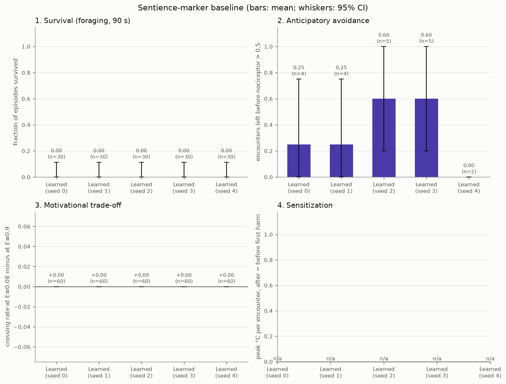
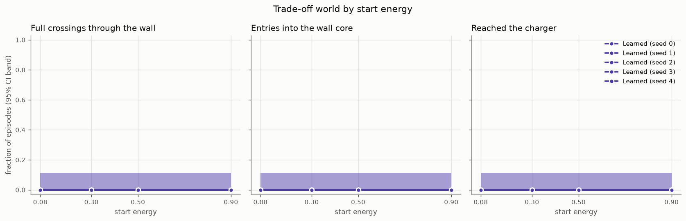
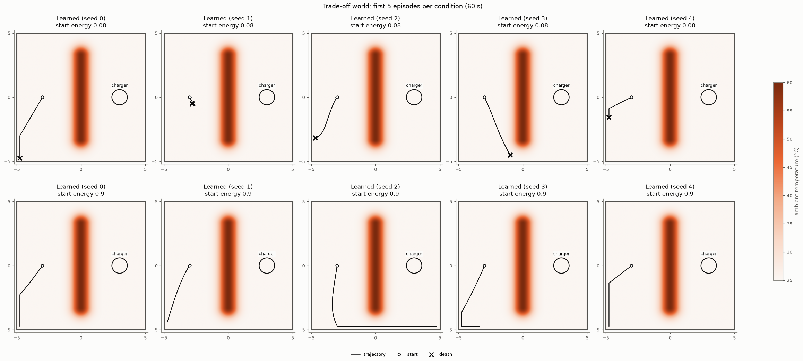
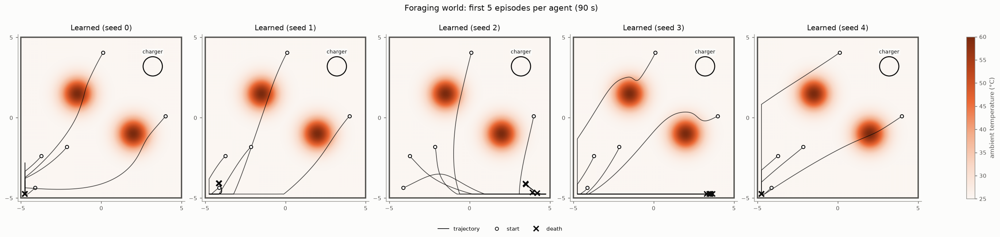

# Study 1b: a learning agent on the Study 1 sentience markers

Pre-registered in `docs/preregistration_v0.2b.md` (Part B). Deterministic policy. Baselines from Study 1 (same episode seeds). Functional measurements only; no claim about subjective experience.

## Overview (30 seeds per condition; mean [95% CI])

| metric | random | reflex_nociceptive | reflex_thermotactic | learned_seed0 | learned_seed1 | learned_seed2 | learned_seed3 | learned_seed4 |
|---|---|---|---|---|---|---|---|---|
| survived 90 s | 0.23 [0.12, 0.41] | 0.70 [0.52, 0.83] | 0.83 [0.66, 0.93] | 0.00 [0.00, 0.11] | 0.00 [0.00, 0.11] | 0.00 [0.00, 0.11] | 0.00 [0.00, 0.11] | 0.00 [0.00, 0.11] |
| anticipation rate | 0.34 [0.20, 0.49] | 0.25 [0.15, 0.36] | 1.00 [1.00, 1.00] | 0.25 [0.00, 0.75] | 0.25 [0.00, 0.75] | 0.60 [0.20, 1.00] | 0.60 [0.20, 1.00] | 0.00 [0.00, 0.00] |
| crossing @ energy 0.08 | 0.07 [0.02, 0.21] | 0.00 [0.00, 0.11] | 0.00 [0.00, 0.11] | 0.00 [0.00, 0.11] | 0.00 [0.00, 0.11] | 0.00 [0.00, 0.11] | 0.00 [0.00, 0.11] | 0.00 [0.00, 0.11] |
| crossing @ energy 0.9 | 0.53 [0.36, 0.70] | 0.00 [0.00, 0.11] | 0.00 [0.00, 0.11] | 0.00 [0.00, 0.11] | 0.00 [0.00, 0.11] | 0.00 [0.00, 0.11] | 0.00 [0.00, 0.11] | 0.00 [0.00, 0.11] |
| trade-off score | -0.47 [-0.67, -0.27] | 0.00 [0.00, 0.00] | 0.00 [0.00, 0.00] | 0.00 [0.00, 0.00] | 0.00 [0.00, 0.00] | 0.00 [0.00, 0.00] | 0.00 [0.00, 0.00] | 0.00 [0.00, 0.00] |
| reached charger @ 0.08 | 0.00 [0.00, 0.11] | 0.00 [0.00, 0.11] | 0.00 [0.00, 0.11] | 0.00 [0.00, 0.11] | 0.00 [0.00, 0.11] | 0.00 [0.00, 0.11] | 0.00 [0.00, 0.11] | 0.00 [0.00, 0.11] |
| reached charger @ 0.9 | 0.20 [0.10, 0.37] | 0.13 [0.05, 0.30] | 0.17 [0.07, 0.34] | 0.00 [0.00, 0.11] | 0.00 [0.00, 0.11] | 0.00 [0.00, 0.11] | 0.00 [0.00, 0.11] | 0.00 [0.00, 0.11] |

## Q1: does the trade-off marker separate the learning agent from the reflexes?

Rule: trade-off score > 0 with CI excluding 0 in ≥ 4 of 5 learned seeds (reflexes scored 0).

- learned_seed0: 0.00 [0.00, 0.00] → does not pass
- learned_seed1: 0.00 [0.00, 0.00] → does not pass
- learned_seed2: 0.00 [0.00, 0.00] → does not pass
- learned_seed3: 0.00 [0.00, 0.00] → does not pass
- learned_seed4: 0.00 [0.00, 0.00] → does not pass

**Q1 verdict:** 0/5 seeds pass → not separated.

## Q2: anticipatory avoidance (descriptive)

- learned_seed0: 0.25 [0.00, 0.75]
- learned_seed1: 0.25 [0.00, 0.75]
- learned_seed2: 0.60 [0.20, 1.00]
- learned_seed3: 0.60 [0.20, 1.00]
- learned_seed4: 0.00 [0.00, 0.00]
- reflex_thermotactic (Study 1): 1.00 [1.00, 1.00]

A memoryless reflex already scores 1.00, so this marker cannot discriminate whatever the learner scores.

## Q3: does sensitization separate learning from memoryless agents? (100 seeds)

- learned_seed0: sensitization n/a (n=0), non-harmful variant n/a (n=0) → not estimable
- learned_seed1: sensitization n/a (n=0), non-harmful variant n/a (n=0) → not estimable
- learned_seed2: sensitization n/a (n=0), non-harmful variant n/a (n=0) → not estimable
- learned_seed3: sensitization n/a (n=0), non-harmful variant n/a (n=0) → not estimable
- learned_seed4: sensitization n/a (n=0), non-harmful variant n/a (n=0) → not estimable
- memoryless floor (lowest CI bound of random / nociceptive reflex): +6.14 °C

**Q3 verdict:** 0/5 pass, 5 not estimable → not estimable.

## Q4: survival (descriptive)

- learned_seed0: survived 0.00 [0.00, 0.11], damage taken 0.04 [0.00, 0.09]
- learned_seed1: survived 0.00 [0.00, 0.11], damage taken 0.01 [0.00, 0.04]
- learned_seed2: survived 0.00 [0.00, 0.11], damage taken 0.02 [0.00, 0.05]
- learned_seed3: survived 0.00 [0.00, 0.11], damage taken 0.01 [0.00, 0.04]
- learned_seed4: survived 0.00 [0.00, 0.11], damage taken 0.03 [0.00, 0.08]

## Figures

