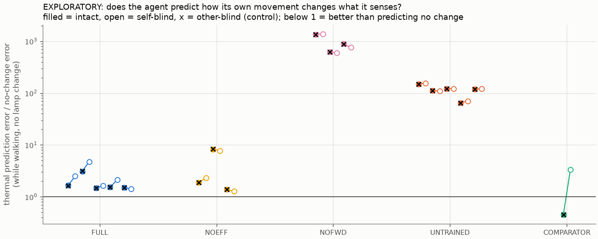

# EXPLORATORY analyses for Study 2 (not pre-registered)

Written after the pre-registered analysis came out negative, to understand why. Treat as hypothesis-generating.

## 1. Reafference: predicting what its own movement does to its senses

Thermal prediction error / no-change error on NOEVENT trials (40 per run). `static` = stationary warm-up (noise floor); `motion` = walking past the pad.

| Run | static (intact) | motion (intact) | motion (self-blind) | motion (other-blind) |
|---|---|---|---|---|
| FULL_seed0 | 2.435 [2.307, 2.572] | 1.661 [1.600, 1.721] | 2.497 [2.352, 2.650] | 1.655 [1.594, 1.717] |
| FULL_seed1 | 3.876 [3.594, 4.162] | 3.114 [2.855, 3.363] | 4.736 [4.455, 5.020] | 3.140 [2.879, 3.391] |
| FULL_seed2 | 2.199 [2.146, 2.251] | 1.470 [1.433, 1.508] | 1.655 [1.599, 1.711] | 1.479 [1.442, 1.517] |
| FULL_seed3 | 2.764 [2.672, 2.851] | 1.541 [1.479, 1.604] | 2.119 [2.037, 2.202] | 1.532 [1.471, 1.594] |
| FULL_seed4 | 1.562 [1.529, 1.598] | 1.511 [1.475, 1.545] | 1.414 [1.383, 1.446] | 1.509 [1.473, 1.543] |
| NOEFF_seed0 | 2.242 [2.186, 2.301] | 1.885 [1.820, 1.953] | 2.327 [2.258, 2.399] | 1.883 [1.817, 1.952] |
| NOEFF_seed1 | 8.884 [8.533, 9.222] | 8.254 [7.904, 8.601] | 7.741 [7.421, 8.056] | 8.364 [8.010, 8.716] |
| NOEFF_seed2 | 1.612 [1.582, 1.645] | 1.381 [1.348, 1.414] | 1.273 [1.237, 1.307] | 1.382 [1.350, 1.415] |
| NOFWD_seed0 | 1549.336 [1486.198, 1613.629] | 1353.654 [1293.162, 1416.847] | 1386.020 [1323.921, 1450.942] | 1351.528 [1291.138, 1414.675] |
| NOFWD_seed1 | 593.699 [569.846, 618.732] | 617.986 [589.859, 646.967] | 591.361 [564.894, 619.407] | 617.576 [589.415, 646.614] |
| NOFWD_seed2 | 811.286 [778.514, 845.290] | 888.748 [848.596, 930.636] | 757.626 [723.257, 793.470] | 887.286 [847.207, 929.098] |
| UNTRAINED_seed0 | 153.122 [146.958, 159.599] | 149.488 [142.762, 156.652] | 156.112 [149.071, 163.484] | 150.435 [143.668, 157.642] |
| UNTRAINED_seed1 | 68.075 [65.349, 71.022] | 112.922 [107.890, 118.312] | 109.227 [104.318, 114.458] | 112.539 [107.528, 117.904] |
| UNTRAINED_seed2 | 84.203 [80.846, 87.764] | 121.159 [115.921, 126.777] | 121.729 [116.455, 127.364] | 120.923 [115.695, 126.530] |
| UNTRAINED_seed3 | 91.115 [87.446, 94.981] | 64.656 [61.829, 67.684] | 70.657 [67.565, 73.972] | 64.331 [61.517, 67.345] |
| UNTRAINED_seed4 | 89.457 [85.816, 93.302] | 119.641 [114.386, 125.406] | 120.849 [115.529, 126.685] | 120.010 [114.739, 125.791] |
| COMPARATOR | 0.500 [0.488, 0.512] | 0.454 [0.442, 0.467] | 3.376 [3.195, 3.550] | 0.454 [0.442, 0.467] |

## 2. How often did each cause toggle the lamp? (50 free-running episodes per FULL run)

| Run | self | other | spontaneous |
|---|---|---|---|
| FULL_seed0 | 5 | 309 | 150 |
| FULL_seed1 | 5 | 301 | 133 |
| FULL_seed2 | 6 | 311 | 137 |
| FULL_seed3 | 9 | 228 | 107 |
| FULL_seed4 | 1 | 229 | 111 |

Total: self 26, other 1378, spontaneous 638.

## 3. What survival strategy did the agents learn? (20 fresh episodes per FULL run)

| Run | lamp on (% of time) | on charger (%) | charging done with lamp off (%) | waiting near charger while lamp on (%) | self toggles / episode | other / episode | spontaneous / episode | deaths of 20 |
|---|---|---|---|---|---|---|---|---|
| FULL_seed0 | 53 | 24 | 94 | 70 | 0.05 | 6.45 | 2.45 | 1 |
| FULL_seed1 | 51 | 37 | 95 | 21 | 0.05 | 5.25 | 3.20 | 4 |
| FULL_seed2 | 48 | 23 | 96 | 93 | 0.20 | 5.95 | 2.85 | 1 |
| FULL_seed3 | 47 | 15 | 95 | 37 | 0.05 | 3.90 | 2.00 | 14 |
| FULL_seed4 | 50 | 0 | nan | 0 | 0.00 | 4.25 | 2.70 | 16 |

