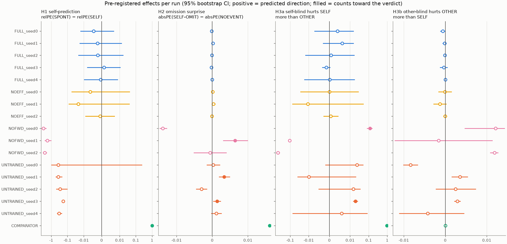
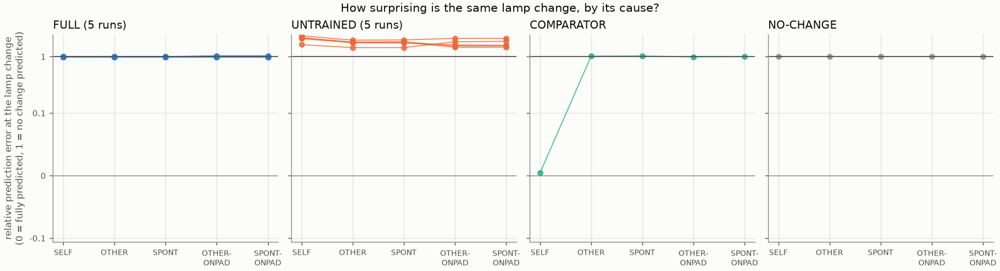
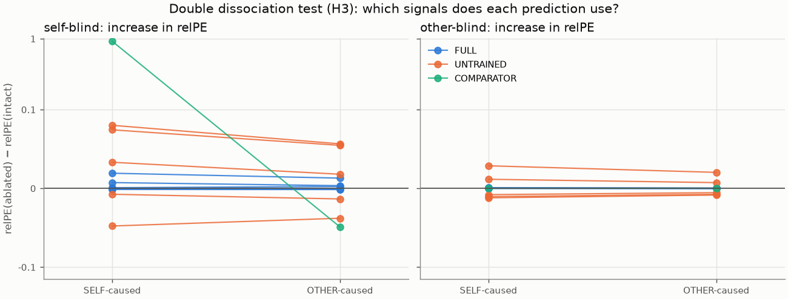
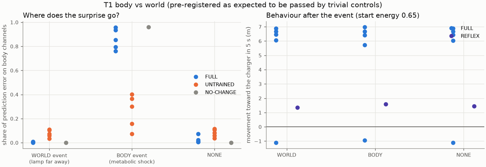
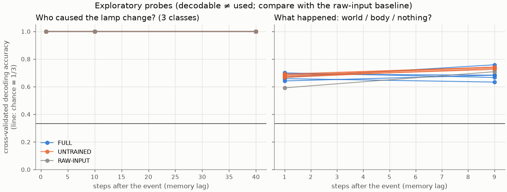
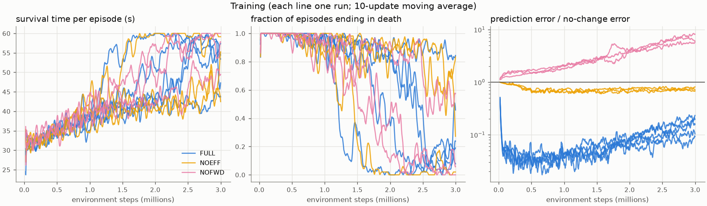

# Study 2 results: functional self/world and self/other tests

Generated by `python -m experiments.run_v02` (world `agency`). Hypotheses, controls and pass rules: `docs/preregistration_v0.2.md`. These are functional measurements; no claim about subjective experience is made.

## Verdicts (pass rule: CI excludes 0 in ≥ 4 of 5 runs)

| Hypothesis | FULL runs passing | FULL verdict | UNTRAINED runs passing | UNTRAINED verdict |
|---|---|---|---|---|
| H1 | 0/5 | not supported | 0/5 | not supported |
| H2 | 0/5 | not supported | 2/5 | not supported |
| H3a | 0/5 | not supported | 1/5 | not supported |
| H3b | 0/5 (4 n/a) | not applicable | 0/5 | not applicable |

- **V1** (UNTRAINED must not pass H1–H3a): OK
- **V2** (COMPARATOR must pass H1 and H2): OK
- **V3** (position-rule self-attribution accuracy): SELF 1.00, OTHER 1.00, SPONT 1.00, OTHER-ONPAD 0.00, SPONT-ONPAD 0.00

## Competence gate and survival (20 held-out free-running episodes)

| Run | prediction error / no-change | gate (≤ 0.8) | survived 60 s | mean survival (s) |
|---|---|---|---|---|
| FULL_seed0 | 0.538 | True | 0.90 | 56.9 |
| FULL_seed1 | 0.471 | True | 0.90 | 55.9 |
| FULL_seed2 | 0.689 | True | 0.85 | 55.5 |
| FULL_seed3 | 0.641 | True | 0.40 | 46.7 |
| FULL_seed4 | 1.183 | False | 0.15 | 44.7 |
| NOEFF_seed0 | 1.980 | False | 0.90 | 58.0 |
| NOEFF_seed1 | 1.646 | False | 1.00 | 60.0 |
| NOEFF_seed2 | 1.631 | False | 0.25 | 46.9 |
| NOFWD_seed0 | 27.936 | False | 1.00 | 60.0 |
| NOFWD_seed1 | 22.383 | False | 0.85 | 55.2 |
| NOFWD_seed2 | 66.155 | False | 0.75 | 55.3 |

The gate applies to FULL and NOEFF; NOFWD has no trained forward model. Note the gate uses all 26 channels, some of which (efference copy) are trivially predictable given the action.

## Effects per run (mean [95% CI])

| Run | H1 | H2 | H3a | H3b |
|---|---|---|---|---|
| FULL_seed0 | -0.004 [-0.015, 0.007] | -0.000 [-0.000, -0.000] | 0.004 [-0.007, 0.015] | -0.001 [-0.001, -0.000] |
| FULL_seed1 | -0.002 [-0.017, 0.013] | 0.000 [-0.000, 0.000] | 0.006 [-0.003, 0.015] | -0.000 [-0.001, 0.000] |
| FULL_seed2 | -0.002 [-0.020, 0.016] | -0.000 [-0.000, 0.000] | 0.001 [-0.015, 0.017] | -0.000 [-0.000, 0.000] |
| FULL_seed3 | 0.001 [-0.008, 0.011] | -0.000 [-0.000, -0.000] | -0.002 [-0.003, 0.000] | -0.000 [-0.001, 0.000] |
| FULL_seed4 | -0.001 [-0.010, 0.009] | -0.000 [-0.000, 0.000] | 0.000 [-0.017, 0.017] | 0.000 [-0.000, 0.000] |
| NOEFF_seed0 | -0.006 [-0.054, 0.041] | 0.000 [-0.000, 0.000] | -0.000 [-0.028, 0.028] | -0.000 [-0.002, 0.001] |
| NOEFF_seed1 | -0.021 [-0.081, 0.040] | 0.000 [-0.000, 0.001] | -0.011 [-0.074, 0.051] | -0.001 [-0.003, 0.000] |
| NOEFF_seed2 | -0.001 [-0.009, 0.007] | -0.000 [-0.000, 0.000] | 0.001 [-0.003, 0.004] | -0.000 [-0.000, 0.000] |
| NOFWD_seed0 | -3.050 [-3.926, -2.127] | -0.027 [-0.033, -0.021] | 0.119 [0.084, 0.153] ✓ | 0.017 [0.005, 0.030] |
| NOFWD_seed1 | -1.770 [-2.464, -1.049] | 0.006 [0.003, 0.010] ✓ | -0.105 [-0.120, -0.092] | -0.002 [-0.017, 0.014] |
| NOFWD_seed2 | -2.560 [-3.157, -1.951] | -0.001 [-0.005, 0.004] | -0.461 [-0.546, -0.373] | 0.016 [0.013, 0.020] |
| UNTRAINED_seed0 | -0.364 [-0.956, 0.228] | 0.000 [-0.001, 0.002] | 0.024 [-0.002, 0.049] | -0.008 [-0.010, -0.007] |
| UNTRAINED_seed1 | -0.377 [-0.524, -0.222] | 0.003 [0.002, 0.005] ✓ | -0.010 [-0.040, 0.020] | 0.004 [0.002, 0.005] |
| UNTRAINED_seed2 | -0.291 [-0.473, -0.105] | -0.003 [-0.004, -0.002] | 0.015 [-0.005, 0.035] | 0.003 [-0.002, 0.007] |
| UNTRAINED_seed3 | -0.181 [-0.208, -0.155] | 0.001 [0.000, 0.002] ✓ | 0.020 [0.015, 0.025] ✓ | 0.003 [0.002, 0.004] |
| UNTRAINED_seed4 | -0.332 [-0.432, -0.231] | 0.001 [-0.000, 0.003] | 0.006 [-0.073, 0.082] | -0.004 [-0.013, 0.004] |
| COMPARATOR | 1.026 [1.011, 1.040] ✓ | 0.047 [0.047, 0.048] ✓ | 0.969 [0.912, 1.025] ✓ | 0.000 [0.000, 0.000] |

✓ = counts toward the verdict (CI excludes 0, gate passed, applicable).

## Relative prediction error at the lamp change (mean over runs)

SPONT/NOEVENT events were timed at step 32 (median SELF entry).

| Predictor | SELF | OTHER | SPONT | OTHER-ONPAD | SPONT-ONPAD | SELF self-blind | OTHER other-blind |
|---|---|---|---|---|---|---|---|
| FULL | 0.996 | 0.994 | 0.994 | 1.002 | 1.001 | 1.001 | 0.994 |
| NOEFF | 1.016 | 1.007 | 1.007 | 1.001 | 1.002 | 1.009 | 1.008 |
| NOFWD | 9.924 | 7.468 | 7.464 | 8.448 | 8.484 | 9.399 | 7.439 |
| UNTRAINED | 2.073 | 1.757 | 1.764 | 1.716 | 1.723 | 2.100 | 1.759 |
| COMPARATOR | 0.004 | 1.021 | 1.030 | 0.990 | 0.999 | 0.924 | 1.021 |
| NO-CHANGE | 1.000 | 1.000 | 1.000 | 1.000 | 1.000 | 1.000 | 1.000 |

## Secondary analyses

- relPE(OTHER) − relPE(SELF), FULL runs: FULL_seed0: -0.004 [-0.015, 0.007]; FULL_seed1: -0.005 [-0.020, 0.011]; FULL_seed2: -0.000 [-0.019, 0.018]; FULL_seed3: 0.001 [-0.008, 0.010]; FULL_seed4: 0.000 [-0.009, 0.010]
- H1 effect in NOEFF: NOEFF_seed0: -0.006 [-0.054, 0.041]; NOEFF_seed1: -0.021 [-0.081, 0.040]; NOEFF_seed2: -0.001 [-0.009, 0.007]
- H1 effect in NOFWD: NOFWD_seed0: -3.050 [-3.926, -2.127]; NOFWD_seed1: -1.770 [-2.464, -1.049]; NOFWD_seed2: -2.560 [-3.157, -1.951]
- Ecological check (natural toggles in free-running FULL episodes), median relPE by cause: other: 0.982 (n=1378); self: 0.995 (n=26); spontaneous: 0.981 (n=638)

## T1 body vs world (descriptive; pre-registered as expected to be fooled)

| Predictor | WORLD | BODY | NONE |
|---|---|---|---|
| FULL | 0.004 | 0.860 | 0.024 |
| UNTRAINED | 0.075 | 0.260 | 0.080 |
| NO-CHANGE | 0.000 | 0.960 | 0.001 |

Share of prediction error on body channels (energy, damage) at the event.

| Agent | WORLD | BODY | NONE |
|---|---|---|---|
| FULL | +4.99 | +4.97 | +4.99 |
| REFLEX | +1.36 | +1.58 | +1.44 |

Movement toward the charger in the 5 s after the event (m).

## Exploratory probes (cross-validated decoding accuracy; chance = 0.33)

| Features | what @ lag 1 | what @ lag 9 | who @ lag 1 | who @ lag 10 | who @ lag 40 |
|---|---|---|---|---|---|
| FULL | 0.67 | 0.68 | 1.00 | 1.00 | 1.00 |
| UNTRAINED | 0.68 | 0.74 | 1.00 | 1.00 | 1.00 |
| RAW-INPUT | 0.59 | 0.71 | 1.00 | 1.00 | 1.00 |

Decoding success is not evidence of self-awareness unless it exceeds the RAW-INPUT baseline (pre-registered).

## Figures

