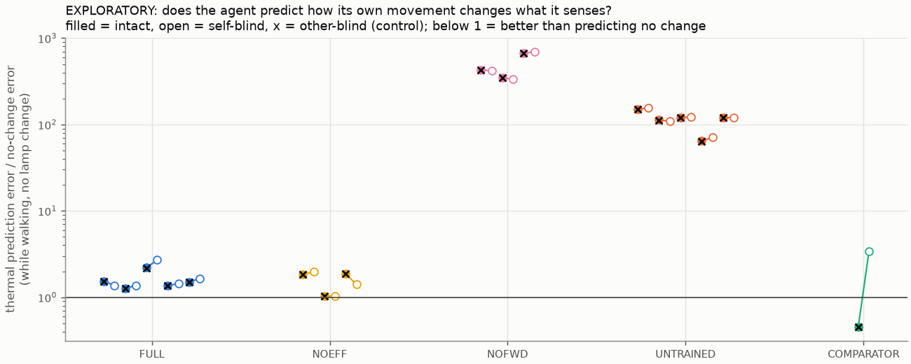

# EXPLORATORY analyses for Study 2 (not pre-registered)

Written after the pre-registered analysis came out negative, to understand why. Treat as hypothesis-generating.

## 1. Reafference: predicting what its own movement does to its senses

Thermal prediction error / no-change error on NOEVENT trials (40 per run). `static` = stationary warm-up (noise floor); `motion` = walking past the pad.

| Run | static (intact) | motion (intact) | motion (self-blind) | motion (other-blind) |
|---|---|---|---|---|
| FULL_seed0 | 1.814 [1.777, 1.854] | 1.541 [1.507, 1.575] | 1.371 [1.347, 1.395] | 1.539 [1.506, 1.573] |
| FULL_seed1 | 1.499 [1.471, 1.529] | 1.256 [1.228, 1.288] | 1.376 [1.340, 1.414] | 1.261 [1.232, 1.292] |
| FULL_seed2 | 3.205 [3.107, 3.309] | 2.202 [2.149, 2.259] | 2.703 [2.619, 2.792] | 2.195 [2.142, 2.251] |
| FULL_seed3 | 1.434 [1.410, 1.459] | 1.367 [1.331, 1.401] | 1.437 [1.401, 1.471] | 1.367 [1.331, 1.401] |
| FULL_seed4 | 1.540 [1.514, 1.566] | 1.506 [1.465, 1.549] | 1.644 [1.602, 1.689] | 1.509 [1.468, 1.552] |
| NOEFF_seed0 | 2.658 [2.568, 2.748] | 1.843 [1.776, 1.912] | 1.986 [1.904, 2.069] | 1.827 [1.762, 1.894] |
| NOEFF_seed1 | 1.128 [1.117, 1.139] | 1.040 [1.027, 1.054] | 1.022 [1.016, 1.028] | 1.039 [1.026, 1.053] |
| NOEFF_seed2 | 1.652 [1.621, 1.685] | 1.864 [1.799, 1.933] | 1.405 [1.374, 1.439] | 1.867 [1.802, 1.936] |
| NOFWD_seed0 | 565.020 [542.557, 589.616] | 430.090 [410.668, 451.353] | 419.398 [400.460, 440.109] | 430.046 [410.627, 451.316] |
| NOFWD_seed1 | 550.200 [524.386, 574.741] | 350.514 [332.476, 369.118] | 333.892 [315.915, 351.799] | 349.492 [331.503, 368.014] |
| NOFWD_seed2 | 682.126 [655.072, 711.256] | 665.638 [636.199, 697.584] | 698.882 [667.981, 732.387] | 665.113 [635.696, 697.033] |
| UNTRAINED_seed0 | 153.122 [146.958, 159.599] | 149.488 [142.762, 156.652] | 156.112 [149.071, 163.484] | 150.435 [143.668, 157.642] |
| UNTRAINED_seed1 | 68.075 [65.349, 71.022] | 112.922 [107.890, 118.312] | 109.227 [104.318, 114.458] | 112.539 [107.528, 117.904] |
| UNTRAINED_seed2 | 84.203 [80.846, 87.764] | 121.159 [115.921, 126.777] | 121.729 [116.455, 127.364] | 120.923 [115.695, 126.530] |
| UNTRAINED_seed3 | 91.115 [87.446, 94.981] | 64.656 [61.829, 67.684] | 70.657 [67.565, 73.972] | 64.331 [61.517, 67.345] |
| UNTRAINED_seed4 | 89.457 [85.816, 93.302] | 119.641 [114.386, 125.406] | 120.849 [115.529, 126.685] | 120.010 [114.739, 125.791] |
| COMPARATOR | 0.500 [0.488, 0.512] | 0.454 [0.442, 0.467] | 3.376 [3.195, 3.550] | 0.454 [0.442, 0.467] |

## 2. How often did each cause toggle the lamp? (50 free-running episodes per FULL run)

| Run | self | other | spontaneous |
|---|---|---|---|
| FULL_seed0 | 0 | 45 | 6 |
| FULL_seed1 | 2 | 46 | 9 |
| FULL_seed2 | 11 | 67 | 11 |
| FULL_seed3 | 45 | 70 | 11 |
| FULL_seed4 | 2 | 38 | 8 |

Total: self 60, other 266, spontaneous 45.

## 3. What survival strategy did the agents learn? (20 fresh episodes per FULL run)

| Run | lamp on (% of time) | on charger (%) | charging done with lamp off (%) | waiting near charger while lamp on (%) | self toggles / episode | other / episode | spontaneous / episode | deaths of 20 |
|---|---|---|---|---|---|---|---|---|
| FULL_seed0 | 66 | 0 | nan | 0 | 0.00 | 1.00 | 0.25 | 20 |
| FULL_seed1 | 66 | 0 | 0 | 24 | 0.05 | 0.95 | 0.25 | 20 |
| FULL_seed2 | 63 | 17 | 95 | 26 | 0.10 | 1.90 | 0.35 | 7 |
| FULL_seed3 | 66 | 6 | 96 | 19 | 0.90 | 1.60 | 0.35 | 9 |
| FULL_seed4 | 67 | 0 | nan | 0 | 0.00 | 0.75 | 0.25 | 20 |

