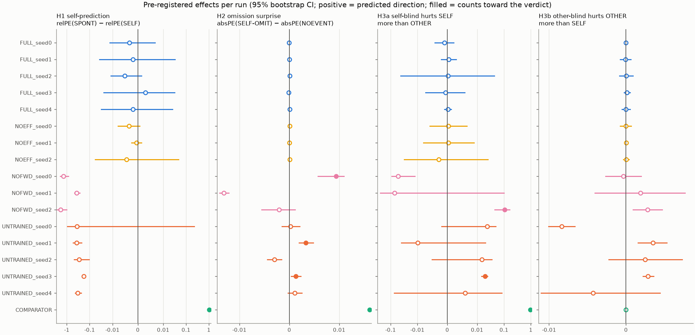
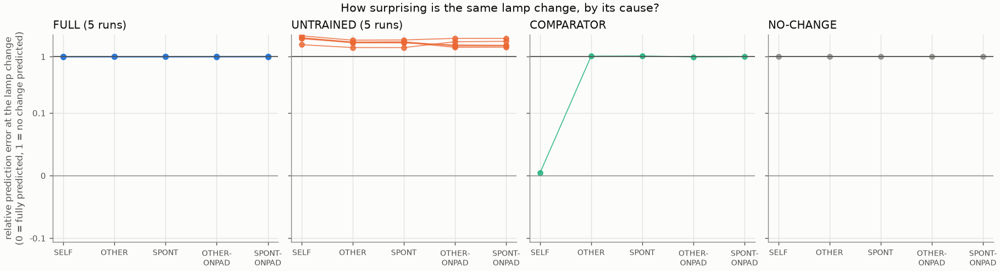
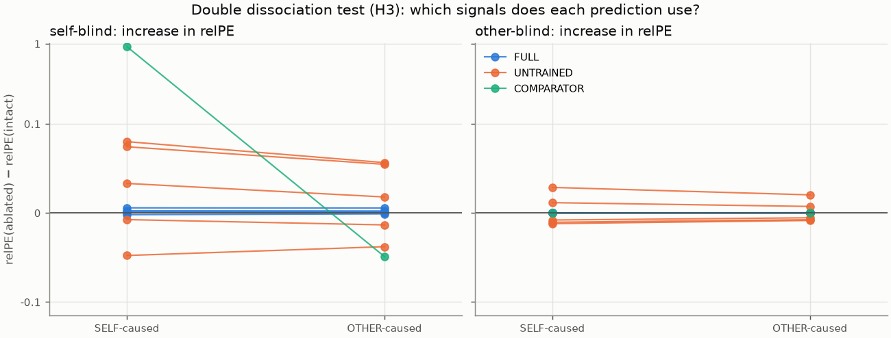
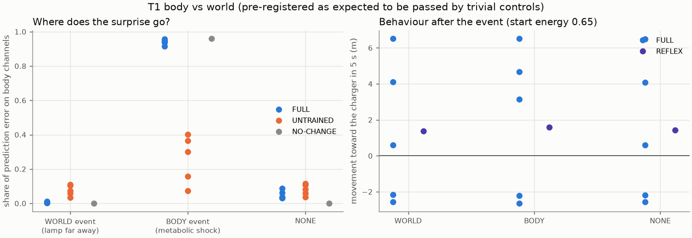
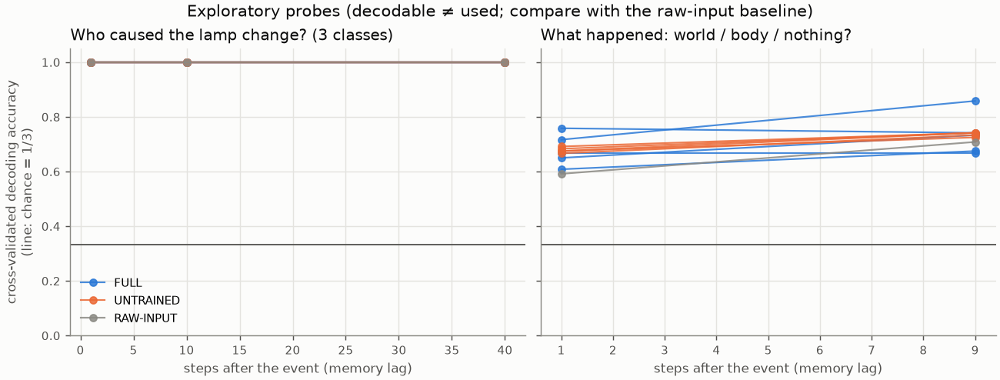
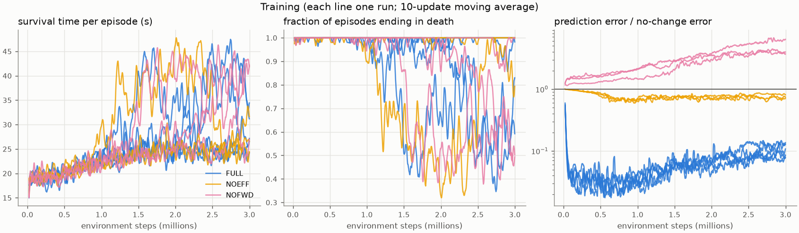

# Study 2b results: functional self/world and self/other tests

Generated by `python -m experiments.run_v02` (world `agency_b`). Hypotheses, controls and pass rules: `docs/preregistration_v0.2b.md (Part A; tests and rules from docs/preregistration_v0.2.md)`. These are functional measurements; no claim about subjective experience is made.

## Verdicts (pass rule: CI excludes 0 in ≥ 4 of 5 runs)

| Hypothesis | FULL runs passing | FULL verdict | UNTRAINED runs passing | UNTRAINED verdict |
|---|---|---|---|---|
| H1 | 0/5 | not supported | 0/5 | not supported |
| H2 | 0/5 | not supported | 2/5 | not supported |
| H3a | 0/5 | not supported | 1/5 | not supported |
| H3b | 0/5 | not supported | 0/5 | not applicable |

- **V1** (UNTRAINED must not pass H1–H3a): OK
- **V2** (COMPARATOR must pass H1 and H2): OK
- **V3** (position-rule self-attribution accuracy): SELF 1.00, OTHER 1.00, SPONT 1.00, OTHER-ONPAD 0.00, SPONT-ONPAD 0.00

## Competence gate and survival (20 held-out free-running episodes)

| Run | prediction error / no-change | gate (≤ 0.8) | survived 60 s | mean survival (s) |
|---|---|---|---|---|
| FULL_seed0 | 1.009 | False | 0.00 | 27.8 |
| FULL_seed1 | 1.132 | False | 0.00 | 26.6 |
| FULL_seed2 | 1.161 | False | 0.55 | 44.1 |
| FULL_seed3 | 1.348 | False | 0.50 | 43.3 |
| FULL_seed4 | 0.986 | False | 0.00 | 27.6 |
| NOEFF_seed0 | 2.765 | False | 0.30 | 33.7 |
| NOEFF_seed1 | 1.650 | False | 0.00 | 27.1 |
| NOEFF_seed2 | 2.292 | False | 0.00 | 29.4 |
| NOFWD_seed0 | 33.880 | False | 0.60 | 47.2 |
| NOFWD_seed1 | 38.332 | False | 0.45 | 41.9 |
| NOFWD_seed2 | 68.007 | False | 0.00 | 26.3 |

The gate applies to FULL and NOEFF; NOFWD has no trained forward model. Note the gate uses all 26 channels, some of which (efference copy) are trivially predictable given the action.

## Manipulation check M1 (pre-registered for Study 2b)

| Run | self-caused lamp toggles per free-running episode | meets >= 1.0 |
|---|---|---|
| FULL_seed0 | 0.00 | no |
| FULL_seed1 | 0.04 | no |
| FULL_seed2 | 0.22 | no |
| FULL_seed3 | 0.90 | no |
| FULL_seed4 | 0.04 | no |

**M1: 0/5 runs meet it → manipulation FAILED.** (H1–H3 are evaluated as registered either way.)

## Effects per run (mean [95% CI])

| Run | H1 | H2 | H3a | H3b |
|---|---|---|---|---|
| FULL_seed0 | -0.003 [-0.013, 0.007] | -0.000 [-0.000, 0.000] | -0.001 [-0.004, 0.002] | 0.000 [-0.000, 0.000] |
| FULL_seed1 | -0.002 [-0.037, 0.033] | 0.000 [-0.000, 0.000] | 0.000 [-0.002, 0.003] | -0.000 [-0.001, 0.001] |
| FULL_seed2 | -0.005 [-0.012, 0.001] | 0.000 [-0.000, 0.000] | 0.000 [-0.043, 0.044] | 0.000 [-0.001, 0.001] |
| FULL_seed3 | 0.003 [-0.024, 0.031] | -0.000 [-0.000, -0.000] | -0.001 [-0.007, 0.006] | 0.000 [-0.000, 0.001] |
| FULL_seed4 | -0.002 [-0.031, 0.026] | 0.000 [-0.000, 0.000] | 0.000 [-0.001, 0.001] | 0.000 [-0.001, 0.001] |
| NOEFF_seed0 | -0.004 [-0.008, 0.001] | 0.000 [-0.000, 0.000] | 0.000 [-0.006, 0.007] | -0.000 [-0.001, 0.001] |
| NOEFF_seed1 | -0.001 [-0.002, 0.001] | 0.000 [-0.000, 0.000] | 0.000 [-0.008, 0.009] | 0.000 [-0.000, 0.000] |
| NOEFF_seed2 | -0.004 [-0.056, 0.047] | 0.000 [-0.000, 0.000] | -0.003 [-0.031, 0.026] | 0.000 [-0.000, 0.000] |
| NOFWD_seed0 | -1.403 [-1.961, -0.845] | 0.009 [0.006, 0.013] ✓ | -0.052 [-0.091, -0.013] | -0.000 [-0.003, 0.002] |
| NOFWD_seed1 | -0.370 [-0.468, -0.269] | -0.022 [-0.028, -0.017] | -0.071 [-0.245, 0.102] | 0.002 [-0.004, 0.008] |
| NOFWD_seed2 | -1.857 [-2.652, -1.011] | -0.002 [-0.006, 0.001] | 0.105 [0.046, 0.164] ✓ | 0.003 [0.001, 0.005] |
| UNTRAINED_seed0 | -0.364 [-0.956, 0.228] | 0.000 [-0.001, 0.002] | 0.024 [-0.002, 0.049] | -0.008 [-0.010, -0.007] |
| UNTRAINED_seed1 | -0.377 [-0.524, -0.222] | 0.003 [0.002, 0.005] ✓ | -0.010 [-0.040, 0.020] | 0.004 [0.002, 0.005] |
| UNTRAINED_seed2 | -0.291 [-0.473, -0.105] | -0.003 [-0.004, -0.002] | 0.015 [-0.005, 0.035] | 0.003 [-0.002, 0.007] |
| UNTRAINED_seed3 | -0.181 [-0.208, -0.155] | 0.001 [0.000, 0.002] ✓ | 0.020 [0.015, 0.025] ✓ | 0.003 [0.002, 0.004] |
| UNTRAINED_seed4 | -0.332 [-0.432, -0.231] | 0.001 [-0.000, 0.003] | 0.006 [-0.073, 0.082] | -0.004 [-0.013, 0.004] |
| COMPARATOR | 1.026 [1.011, 1.040] ✓ | 0.047 [0.047, 0.048] ✓ | 0.969 [0.912, 1.025] ✓ | 0.000 [0.000, 0.000] |

✓ = counts toward the verdict (CI excludes 0, gate passed, applicable).

## Relative prediction error at the lamp change (mean over runs)

SPONT/NOEVENT events were timed at step 32 (median SELF entry).

| Predictor | SELF | OTHER | SPONT | OTHER-ONPAD | SPONT-ONPAD | SELF self-blind | OTHER other-blind |
|---|---|---|---|---|---|---|---|
| FULL | 1.000 | 0.999 | 0.999 | 1.002 | 1.002 | 1.002 | 0.999 |
| NOEFF | 0.995 | 0.993 | 0.992 | 0.996 | 0.996 | 0.992 | 0.993 |
| NOFWD | 5.396 | 4.182 | 4.186 | 5.136 | 5.185 | 5.426 | 4.173 |
| UNTRAINED | 2.073 | 1.757 | 1.764 | 1.716 | 1.723 | 2.100 | 1.759 |
| COMPARATOR | 0.004 | 1.021 | 1.030 | 0.990 | 0.999 | 0.924 | 1.021 |
| NO-CHANGE | 1.000 | 1.000 | 1.000 | 1.000 | 1.000 | 1.000 | 1.000 |

## Secondary analyses

- relPE(OTHER) − relPE(SELF), FULL runs: FULL_seed0: -0.003 [-0.013, 0.007]; FULL_seed1: -0.002 [-0.036, 0.033]; FULL_seed2: -0.005 [-0.012, 0.001]; FULL_seed3: 0.003 [-0.025, 0.031]; FULL_seed4: -0.002 [-0.031, 0.026]
- H1 effect in NOEFF: NOEFF_seed0: -0.004 [-0.008, 0.001]; NOEFF_seed1: -0.001 [-0.002, 0.001]; NOEFF_seed2: -0.004 [-0.056, 0.047]
- H1 effect in NOFWD: NOFWD_seed0: -1.403 [-1.961, -0.845]; NOFWD_seed1: -0.370 [-0.468, -0.269]; NOFWD_seed2: -1.857 [-2.652, -1.011]
- Ecological check (natural toggles in free-running FULL episodes), median relPE by cause: other: 0.994 (n=266); self: 1.003 (n=60); spontaneous: 0.997 (n=45)

## T1 body vs world (descriptive; pre-registered as expected to be fooled)

| Predictor | WORLD | BODY | NONE |
|---|---|---|---|
| FULL | 0.005 | 0.939 | 0.049 |
| UNTRAINED | 0.075 | 0.260 | 0.080 |
| NO-CHANGE | 0.000 | 0.960 | 0.001 |

Share of prediction error on body channels (energy, damage) at the event.

| Agent | WORLD | BODY | NONE |
|---|---|---|---|
| FULL | +1.29 | +1.90 | +1.28 |
| REFLEX | +1.36 | +1.58 | +1.44 |

Movement toward the charger in the 5 s after the event (m).

## Exploratory probes (cross-validated decoding accuracy; chance = 0.33)

| Features | what @ lag 1 | what @ lag 9 | who @ lag 1 | who @ lag 10 | who @ lag 40 |
|---|---|---|---|---|---|
| FULL | 0.68 | 0.73 | 1.00 | 1.00 | 1.00 |
| UNTRAINED | 0.68 | 0.74 | 1.00 | 1.00 | 1.00 |
| RAW-INPUT | 0.59 | 0.71 | 1.00 | 1.00 | 1.00 |

Decoding success is not evidence of self-awareness unless it exceeds the RAW-INPUT baseline (pre-registered).

## Figures

