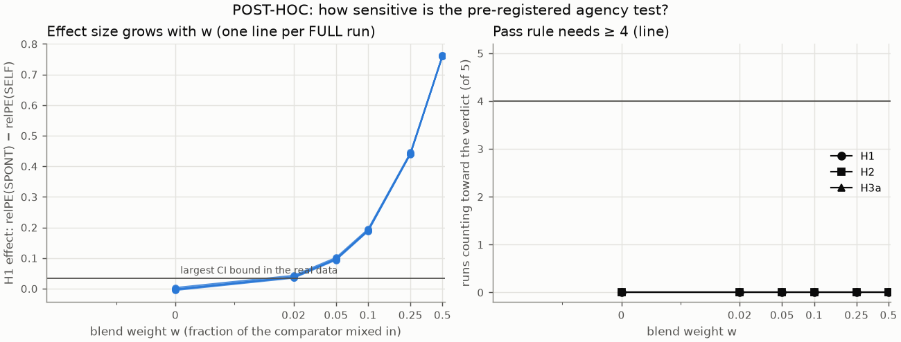

# POST-HOC sensitivity of the Study 2 agency test (not pre-registered)

Blended predictor = (1 − w) × trained FULL agent + w × hand-built comparator (heat channels). Same T2 battery, 40 trials per condition, same pass rule (≥ 4 of 5 runs; runs that fail the competence gate never count).

| w | H1 effect (mean of 5 runs) | H1 runs passing | H2 runs passing | H3a runs passing | Would H1 be declared supported? | H1 CI > 0 ignoring the gate |
|---|---|---|---|---|---|---|
| 0.0 | -0.002 | 0/5 | 0/5 | 0/5 | no | 0/5 |
| 0.02 | +0.038 | 0/5 | 0/5 | 0/5 | no | 5/5 |
| 0.05 | +0.097 | 0/5 | 0/5 | 0/5 | no | 5/5 |
| 0.1 | +0.191 | 0/5 | 0/5 | 0/5 | no | 5/5 |
| 0.25 | +0.442 | 0/5 | 0/5 | 0/5 | no | 5/5 |
| 0.5 | +0.761 | 0/5 | 0/5 | 0/5 | no | 5/5 |

**Smallest blend weight detected by the pre-registered rule:** none tested.
**Equivalence bound from the actual data:** every FULL run's H1 95% CI lies below +0.033 (relative prediction error units).

